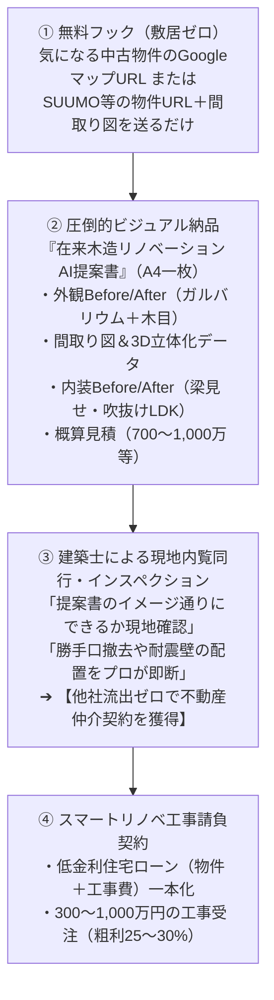

# EIE不動産 在来木造リノベーションAI提案書＆スマートリノベ事業 設計書

**作成日**: 2026年10月25日  
**対象ページ**: `src/pages/EieRealEstatePage.jsx` (`https://eie.smile049.jp/`)  
**対象コンポーネント**: `src/components/eie/*`, `src/components/Plan3dAiModal.jsx`, `src/components/RenoveBeforeAfterSlider.jsx`

---

## 1. 事業の根底思想とビジネスモデル

### 【コアコンセプト】
**「Googleマップ（外観Before）× 間取り図3D化 × 築年数別内装AI（Stable Diffusion）＋ 300〜1,000万明朗見積 ＝ 『在来木造リノベーションAI提案書』」**

中古戸建て購入を検討しているユーザーの最大の不安（「古臭い・寒い・いくらかかるか分からない」）を、購入前の段階で一瞬にして「ここに住みたい！」というワクワク感と安心感に変え、**「仲介手数料」＋「スマートリノベ工事（300〜1,000万円）」を完全ワンストップで総取り**する。

---

## 2. 4段階のコンバージョン導線（仲介＆工事受注）

---

## 3. キラーコンテンツ仕様（他社リフォーム会社との決定的差別化）

### 3-1. 透明性MAX「スマイチ・スマートリノベパッケージ（300万〜1,000万円）」
メーカー名・商品名をすべてオープンにし、価格と仕様の不透明感を全廃。

- **【生活動線・収納革命】**
  - **使わない勝手口の撤去**（隙間風・防犯不安を解消、壁面を耐力壁＆大型パントリーへ転換）
  - **パントリー（食品庫）増築**（買い置き・非常食がすっきり収まる収納革命）
  - 玄関ポーチ拡張・デコレーション
- **【温熱・快適性（ヒートショック撲滅）】**
  - ほぼ全窓への内窓設置（YKK AP プラマードU 等 / 先進的窓リノベ補助金連動）
  - 基礎断熱工法
  - LD・洗面所・トイレの3点床暖房（冬場も素足で過ごせる極上の暖かさ）
- **【水回り設備総刷新】**
  - 高断熱浴槽システムバス（TOTO サザナ 等）
  - 洗面化粧台（LIXIL 等）
  - 省エネ高効率給湯器
  - システムキッチン（Panasonic 等、パッケージ内に明示）
- **【デザイン＆省エネ】**
  - 全室クロス張替え ＋ 一部アクセント無垢羽目板張り
  - 太陽光発電設備設置（※屋根荷重と構造安全確認を前提）

### 3-2. 「角の壁は触らない」技術屋のスマート耐震補強（キラーフレーズ）
- **一般的な工務店・リフォーム会社**:
  - 闇雲に角の壁を剥がし、ホールダウン金物を追加しようとして基礎工事まで巻き込み、費用が数百万円跳ね上がる。
- **スマイチの技術屋スマート耐震**:
  - **「角の壁は触らない。ホールダウン金物が必要な補強はしない」**
  - 構造計算（重心・剛心）を自社でコントロールし、**「基礎に負担をかけない家の内部でバランス良く補強」**。
  - 解体費用と基礎費用を最小化しながら耐震性能を確実に引き上げる。
  - リフォーム同時施工オプション：`@〇〇円/㎡〜`

---

## 4. SEO / AIO（AI Overview・検索生成最適化）戦略

AI検索エンジン（Perplexity, SearchGPT, Google AIO）が「埼玉県の中古住宅購入・リノベの最適解」として引用する構造。

1. **定義文（Definition Hook）**:
   - 「EIE不動産とは、埼玉県（川越・坂戸・鶴ヶ島等）において、Googleマップと間取り図からAIリノベ提案書を事前作成し、建築士による耐震断熱リノベと仲介・住宅ローンを一体提供するワンストップサービスです。」
2. **重点インテント＆キーワード**:
   - `埼玉 中古戸建て リノベーション 費用`
   - `勝手口 撤去 パントリー リフォーム`
   - `中古住宅 耐震補強 費用 抑える ホールダウン金物`
   - `埼玉 中古住宅 内窓 補助金 先進的窓リノベ`

---

## 5. 次回再開時のアクションプラン（ステップバイステップ）

別チャットから戻った際は、以下の順番で実装を進めます：

1. **【ステップ1】EieRealEstatePage のワイヤーフレーム・コピー改修**:
   - ヒーローセクション：AI提案書のビジュアル（Before/After）をメインビジュアルに据え、「URLと間取り図を送るだけ」の低ハードルCTAを設置。
   - 「3大ペインの代弁」と「新築vs中古＋スマートリノベの予算対比」。
2. **【ステップ2】キラーコンテンツのコンポーネント化**:
   - 「勝手口撤去 ＆ パントリー増築」の図解セクション。
   - 「角の壁は触らないスマート耐震」の構造解説セクション。
   - 「300〜1,000万円明朗パッケージ表」（メーカー名・品番入り）。
3. **【ステップ3】「AI提案書」無料受付フォーム＆内覧同行CTAの実装**:
   - 物件URL＋間取り図送信フォーム（またはLINE直通リンク）。
   - 建築士のインスペクション内覧同行予約システム。
