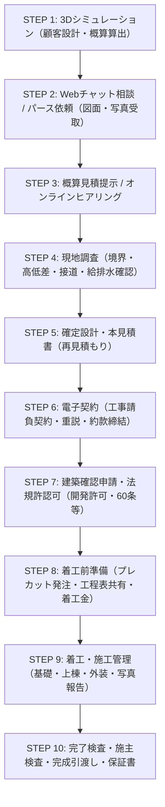

# スマイチ 木造自由設計ガレージ DX業務フロー＆オペレーションマニュアル
**3Dシミュレーション・Webチャットから電子契約・着工・完成引渡しまでの全10ステップ標準仕様**

- 発行元: 株式会社 住ま居る
- 発行日: 2026年11月13日 (Ver 1.0)
- 印刷用HTML: [public/manual/workflow_guide_a4.html](file:///d:/Dropbox/■住ま居る/■住ま居る共有/スマイチ/Antigravity/public/manual/workflow_guide_a4.html)（ブラウザからA4縦2ページで印刷・PDF保存可能）

---

## 0. 基本原則・コンセプト
1. **顧客との対話・図面提出はすべて「Webチャット（重要図書スロット）」に集約**
   - 担当者個人のLINEやメールによるやり取りの分散を防止。
   - すべての対話ログ・提出図面（CAD/公図/現地写真）・パース・見積書を社内管理ポータルで一元管理します。
2. **公式LINE（`https://line.ee/8fdyyGu`）は「更新通知専用」**
   - トークでの個別対応は行わず、「AIパースが完成しました」「新しいメッセージが届きました」のPush通知受取窓口として案内します。
3. **社内即時通知体制**
   - 新規問い合わせ・パース依頼・メッセージ受信時は、社内3宛先（`help@t-smile.co.jp`, `keiri@t-smile.co.jp`, `sato@t-smile.co.jp`）へ自動同報されます。

---

## 1. 全体業務プロセス（全10ステップ）

| ステップ | フェーズ名 | お客様のアクション (Webポータル) | 社内スタッフのアクション (管理画面/現場) | 主担当 |
| :---: | :--- | :--- | :--- | :---: |
| **STEP 1** | **3Dシミュレーション** | 間口・奥行・外壁・サッシ・愛車を3D上で自由に設計し、リアルタイム概算金額を確認。 | シミュレータのアクセスログ監視。未問合せの大型・事業用プランの傾向分析。 | 営業/設計 |
| **STEP 2** | **チャット相談・パース依頼** | 要望送信、敷地配置図(.dxf/PDF)や現地写真を重要図書スロットへ添付提出。 | 社内メール(3宛先)通知着信。管理画面で顧客カードを開き、Stable DiffusionでAIパース作成・返信。 | 全社 / 設計 |
| **STEP 3** | **概算見積提示・ヒアリング** | AIパースと概算仕様書の確認。予算感や追加要望（電気配線・土間仕様等）の相談。 | チャット内で概算見積書を提示。現地調査の日程打診（土日・平日希望ヒアリング）。 | 営業 |
| **STEP 4** | **現地調査 (境界・現況確認)** | 現地立ち会い（不在調査承諾も可）。隣地境界や障害物等の現場確認。 | 境界杭・接道幅員・高低差・水道電気引込・地盤目視。スマホで現況写真カルテを作成。 | 工務/設計 |
| **STEP 5** | **確定設計・本見積 (再見積)** | 現地寸法を反映した確定配置図・実施設計パース・本見積書の確認・承諾。 | 正式CAD図面作成、プレカット積算、基礎・土間・サッシ明細を含む確定本見積書発行。 | 設計/工務 |
| **STEP 6** | **電子契約 (工事請負契約)** | チャット内で重要事項説明・約款を確認し、電子署名（認証同意）を完了。 | 電子契約締結書の相互保管、契約番号発番、契約金請求書の発行と着金確認。 | 事務/経理 |
| **STEP 7** | **建築確認申請・法規許認可** | 確認申請委任状への同意、印鑑証明等の必要公的書類のアップロード。 | 指定確認検査機関への建築確認申請提出、市街化調整区域の開発許可（60条証明等）手続き。 | 設計 |
| **STEP 8** | **着工前準備・工程表共有** | チャットで共有された工程表の確認、地鎮祭日程調整、近隣挨拶の確認。 | 木材プレカット発注、職人（基礎・建方・屋根・電気）手配、近隣挨拶状の投函。 | 工務 |
| **STEP 9** | **着工・施工管理 (基礎〜建方)** | ポータル上で「配筋完了」「上棟」「外装施工」の現場写真をタイムラインで確認。 | 基礎配筋検査、上棟、構造金物検査、透湿防水シート・外装・シャッター施工と写真登録。 | 工務 |
| **STEP 10** | **完了検査・施主検査・引渡し** | 現場での最終仕上がり検査、設備機器取説受領、残金清算、鍵受領。 | 確認検査機関の完了検査済証受領、保証書交付、鍵引き渡し、アフター点検登録。 | 営業/工務 |

---

## 2. 担当者別アクションマトリクス

### ① 営業担当 (セールス)
- 新規チャットへの一次返信（目標15分以内）
- 概算見積・オプション（電動シャッター、断熱、内装OSB等）のヒアリング
- 現地調査日程の確定調整
- 電子契約のご案内と締結促進

### ② 設計担当 (アーキテクト)
- 3Dデータをもとに社内Stable Diffusion PCでAIフォトリアルパース生成
- 顧客提出の公図・CADの法令チェック（建ぺい率・容積率・斜線制限）
- 敷地配置図・確定CAD図面作成
- 建築確認申請・市街化調整区域（法第60条適合証明書等）の行政協議

### ③ 工務担当 (ディレクター)
- 現地調査（接道幅員4m以上確認・境界杭・高低差・電柱・埋設管）
- プレカット工場・職人（基礎・大工・外装・サッシ・電気）の手配
- 施工管理（配筋検査・金物検査・気密防水）と現場写真のポータル登録
- 指定確認検査機関の完了検査立会い、施主完成立ち会い・引渡し

### ④ 事務・経理 (バックオフィス)
- チャット通知メール（`help@t-smile.co.jp`, `keiri@t-smile.co.jp`, `sato@t-smile.co.jp`）の着信監視
- 契約番号・案件IDの発番と台帳記録
- 契約金（30%）、着工金（40%）、完了金（30%）の請求書発行と着金管理
- 保証書・重要図書（確認済証・検査済証）の電子保管

---

## 3. 電子契約（工事請負契約）の締結プロトコル
- **STEP A（書類作成）**: 管理画面より確定図面・本見積金額・工期を反映した【民間連合協定準拠 工事請負契約書】PDFを生成。
- **STEP B（開示と説明）**: チャット重要図書スロットへ送付。顧客へ重要事項説明・特約事項のオンライン説明を実施。
- **STEP C（電子署名）**: 顧客が認証ワンタイムコードを入力し「契約約款に同意して契約締結」を実行。
- **STEP D（締結・保管）**: 電子署名済み確定PDFが双方に自動交付・暗号化保管。経理へ請求書発行通知が送信。

---

## 4. 管理画面ログイン・緊急時窓口
- **管理画面URL**: `https://smile049.jp/#staff-admin`
- **共通パスコード**: `smile049`
- **自動通知メール先**:
  - `help@t-smile.co.jp`
  - `keiri@t-smile.co.jp`
  - `sato@t-smile.co.jp`
- **公式LINE（通知専用）**: `https://line.ee/8fdyyGu`

